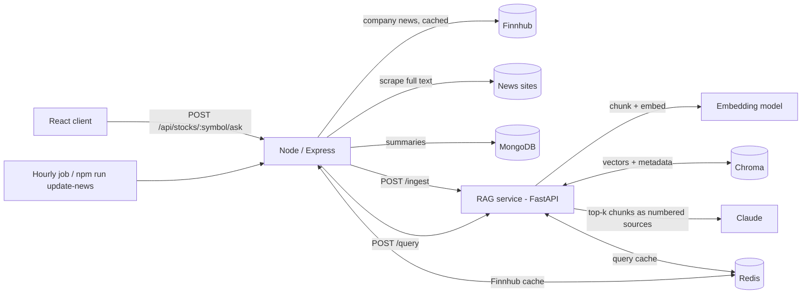

# StockNews

A web app for stock news. It scrapes recent articles for each tracked stock, summarises them, and answers questions about a stock with citations to the articles it used. The citations come from a retrieval-augmented generation (RAG) pipeline.

## Features

- Finnhub company news, scraped to full text and summarised with BART (`@xenova/transformers`)
- **Ask about this stock:** natural-language Q&A over the scraped news, with cited sources
- RAG service: ~500-token chunks with overlap, embeddings, a Chroma vector store, retrieval filtered by symbol and date, and LLM answers that cite their sources
- Redis caching for repeated questions and for Finnhub responses
- Retrieval eval (hit rate, MRR, citation rate) and a cache latency benchmark
- `docker compose up` runs the whole stack

## Tech stack

| Layer | Tech |
| --- | --- |
| Frontend | React, Material UI, Chart.js |
| API | Node.js, Express, Mongoose, node-cron, ioredis |
| RAG service | Python, FastAPI, Chroma |
| Embeddings | all-MiniLM-L6-v2 (local ONNX, default), OpenAI, or Amazon Bedrock Titan |
| Answer LLM | Claude via the Anthropic API (default), OpenAI, or Claude on Amazon Bedrock |
| Data | MongoDB (stocks and summaries), Chroma (vectors), Redis (cache) |
| News | Finnhub API, newspaperjs scraping |

## Architecture



**Ingest.** After each scrape, the Node server posts the full article text to `POST /ingest` with symbol, title, URL, source and publish date. The RAG service splits each article into ~500-token chunks with 75 tokens of overlap, cutting on sentence boundaries. It embeds the chunks and upserts them into Chroma with that metadata. Re-ingesting a URL replaces its chunks. Ingesting new articles for a symbol invalidates that symbol's cached answers.

**Query.** `POST /api/stocks/:symbol/ask` proxies to `POST /query`. The service embeds the question and retrieves the top-k chunks, filtered by `symbol` and optionally by `days`. It sends them to the LLM as numbered excerpts, with instructions to answer only from them and cite each claim as `[n]`. It returns the answer, citations (the sources the answer actually cited, with URLs), the retrieved chunks with similarity scores, timings and token usage.

```bash
curl -X POST localhost:5000/api/stocks/AAPL/ask -H "Content-Type: application/json" \
  -d '{"question": "What is the latest news risk for AAPL?"}'
```

## Run with Docker

```bash
cp .env.example .env        # add ANTHROPIC_API_KEY and FINNHUB_API_KEY
docker compose up --build
```

- Web UI: http://localhost:3000
- API: http://localhost:5000
- RAG service docs: http://localhost:8001/docs

The stack has six services: `client`, `server`, `rag-service`, `mongo`, `chroma` and `redis`.

To get news in, either:

- Run the scraper: `docker compose exec server npm run update-news AAPL TSLA` (needs a Finnhub key). Set `NEWS_CRON_ENABLED=true` to run it hourly.
- Load the synthetic demo articles: `docker compose exec rag-service python -m scripts.seed_demo`

Then open a stock page, for example http://localhost:3000/stock/AAPL, and use **Ask about this stock**.

Without an `ANTHROPIC_API_KEY`, set `LLM_PROVIDER=extractive`. Answers are then stitched together from the most relevant retrieved sentences, with citations, and no LLM is called.

## Run without Docker

```bash
# RAG service
cd rag-service
python -m venv .venv && .venv/Scripts/activate    # or source .venv/bin/activate
pip install -r requirements-dev.txt
uvicorn app.main:app --port 8001                   # on-disk Chroma in ./data; set REDIS_URL to enable caching

# API (needs MongoDB; Redis is optional)
cd server && npm install && npm run dev

# Client
cd client && npm install && npm start
```

### RAG service configuration

| Variable | Default | Notes |
| --- | --- | --- |
| `EMBEDDING_PROVIDER` | `local` | `local`, `openai`, `bedrock` (`hash` is for tests only) |
| `EMBEDDING_MODEL` | per provider | e.g. `text-embedding-3-small`, `amazon.titan-embed-text-v2:0` |
| `LLM_PROVIDER` | `anthropic` | `anthropic`, `openai`, `bedrock`, `extractive` |
| `LLM_MODEL` | `claude-opus-5-5` | Bedrock default: `anthropic.claude-opus-5-5` |
| `LLM_EFFORT` | `low` | Anthropic effort level |
| `LLM_FALLBACK_MODEL` | `claude-opus-4-8` | The API retries on this model if the main model declines; `none` disables it |
| `CHROMA_HOST` / `CHROMA_PORT` | unset / `8000` | Unset means an on-disk store at `CHROMA_PATH` |
| `REDIS_URL` | unset | Unset disables the query cache |
| `QUERY_CACHE_TTL` | `600` | Seconds |
| `CHUNK_TOKENS` / `CHUNK_OVERLAP` / `TOP_K` | `500` / `75` / `5` | |

Each embedding model gets its own Chroma collection, so switching providers never mixes vectors.

## Evaluation

`rag-service/eval/` contains 13 synthetic articles across AAPL, TSLA, MSFT and AMZN, and 10 questions labelled with the article(s) that answer them. The articles were written for the eval and aren't real news. Several stocks have distractor articles on unrelated topics.

```bash
cd rag-service
python -m eval.run_eval --k 3
```

For each question it records:

- **hit@k:** an expected article is among the top-k retrieved chunks
- **MRR:** reciprocal rank of the first expected article
- **citation rate:** the answer cites at least one source, and every citation points to a retrieved source

Results with the default local embeddings (all-MiniLM-L6-v2), measured on 2026-11-13:

| k | hit@k | MRR | Citation rate |
| --- | --- | --- | --- |
| 1 | 90% | 0.90 | 100% |
| 3 | 100% | 0.95 | 100% |

These runs used the `extractive` answer provider (no API key was available). The citation rate therefore confirms the citation plumbing, not an LLM's citing behaviour. Re-run with `ANTHROPIC_API_KEY` set to measure Claude's citation rate. The eval set is small and synthetic, so treat these numbers as a regression check, not a benchmark.

## Caching

- **Query cache (RAG service):** `/query` responses are cached in Redis, keyed by symbol, question and parameters. Each key includes a per-symbol version that `/ingest` increments, so new articles invalidate old answers immediately. Cached responses come back with `"cached": true`.
- **Finnhub cache (Node):** company-news responses are cached for 15 minutes per symbol and date range.
- If Redis is unset or unreachable, both caches are skipped and requests still succeed.

```bash
cd rag-service
python -m scripts.bench_cache --runs 20                              # in-process, fakeredis
python -m scripts.bench_cache --url http://localhost:8001 --runs 20  # against the running stack
```

Measured in-process (local embeddings, `extractive` answers, fakeredis) on 2026-11-13:

| | p50 | p95 |
| --- | --- | --- |
| Cache miss (embed + retrieve + answer) | 194.9 ms | 196.9 ms |
| Cache hit | 0.56 ms | 1.68 ms |

That is a 99.7% lower p50 on repeat queries. This baseline has no LLM call. With Claude generating the answer, a miss takes seconds and a hit stays around a millisecond plus the Redis round trip, so the real saving is larger. Run the `--url` form against `docker compose` for numbers with real Redis and a real LLM.

## Tests

```bash
cd rag-service && pytest
```

The tests cover chunk sizes and overlap, ingest and symbol-filtered retrieval, the date filter, citations pointing only at retrieved sources, re-ingest replacing chunks, cache hits and invalidation, cache fallback when Redis is down, and input validation. They use a hashing embedder and in-memory Chroma, so they need no network or model download.

## API endpoints

| Endpoint | Method | Description |
| --- | --- | --- |
| `/api/stock_info/:stock` | GET | Stored stock details and news summaries |
| `/api/stock_list` | POST | Tracked stocks (auth) |
| `/api/stocks/:symbol/ask` | POST | `{question, days?}` returns a cited answer from the RAG service |
| `/api/login` | POST | Log in, returns a JWT |

RAG service: `POST /ingest`, `POST /query`, `GET /health`.

## License

MIT
